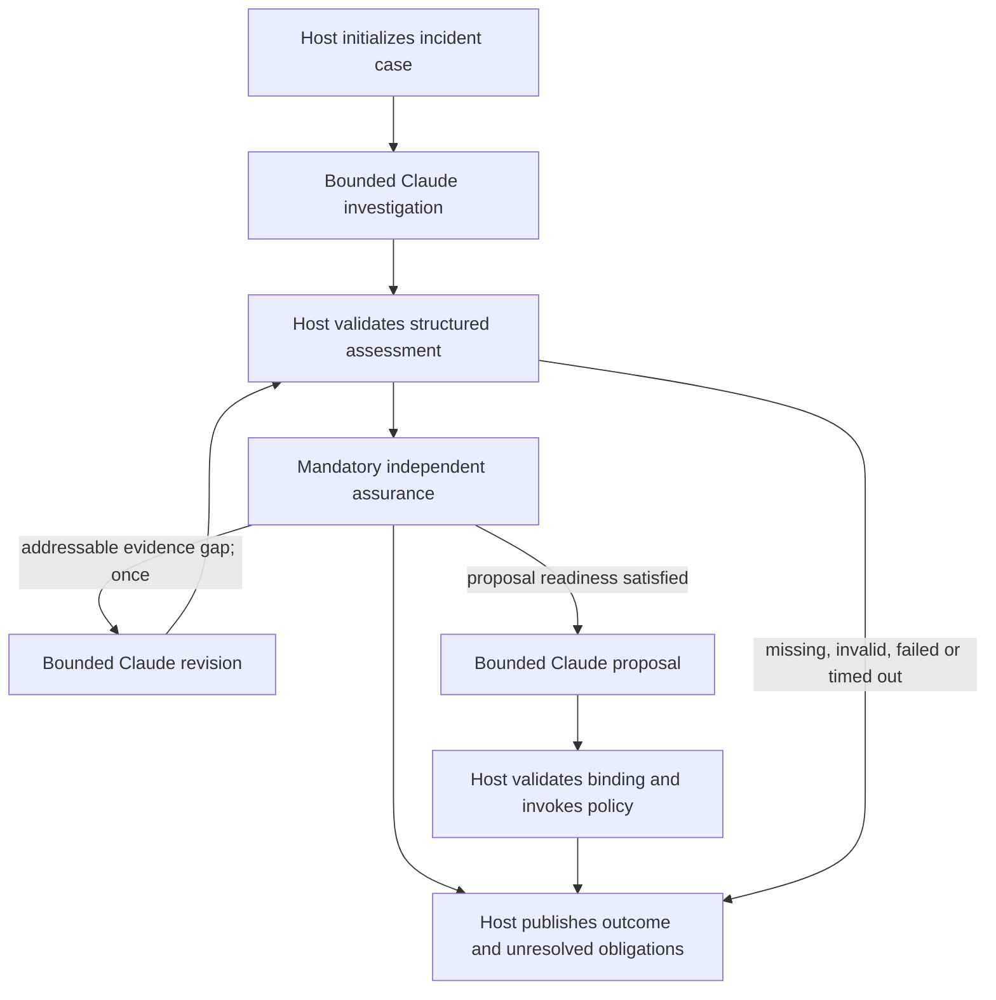

# Investigator — host-owned operational decision assurance

Status: M2-B implemented on `codex/investigator-m2-host`. Investigator is read-only; proposals never grant execution authority. See the [implementation and offline evidence report](../evaluation/investigator-m2-host-assurance.md) for foundation ancestry, test coverage, an actual transition trace, and limitations.

## Control boundaries

Claude owns reasoning loops. The host owns workflow progression. Independent Operational Decision Assurance determines whether the requirements for the proposed transition are satisfied.

The application invokes a bounded Claude SDK stage, validates its structured output, calls the M2-A evaluator directly, and records the result. No assurance tool call is required from Claude. Omitting an assessment cannot bypass evaluation or produce an authorized proposal.



## Small application modules

| Module | Responsibility |
|---|---|
| `reelix_eval/case.py` | Versioned case identity, current state, immutable event payloads, exclusive filesystem checkpoints |
| `reelix_eval/orchestration.py` | Explicit transitions, typed stage submissions, revision budget, host evaluation and publication |
| `reelix_eval/trust.py` | Reused M2-A contracts, evidence resolver, condition evaluation and policy decisions |
| `reelix_eval/agent/stages.py` | Bounded SDK calls, scoped diagnostic tool server, specialist delegation, source provenance |
| `reelix_eval/agent/run.py` | Application configuration, preflight, incident scope discovery and assembly |
| `reelix_eval/report.py` | Strict finding validation and atomic immutable report publication |

The case records mandate/window, permitted query IDs and source scope, capabilities, initial source manifest and Git revision, policy identity, evidence observations, assessment revisions, feedback, proposals, decisions, existing host receipts, transitions, errors and final outcome. Each accepted assessment and decision records its case/evidence/policy/source binding. Earlier assessments remain in history.

Checkpoints live at `<reports_dir>/.cases/<case_id>/<sequence>.json`. They support inspection after failure or process restart. Execution does not resume an existing case. There is no database, distributed state, fsync guarantee or general workflow engine.

## Lifecycle and standards

An investigation submission contains a typed `InvestigationAssessment` and either one strictly validated `Finding` or a clean/inconclusive outcome. A scoped host helper normalizes a finding and computes its digest. It grants no assurance. Unknown references remain unmet obligations; claim payloads never enter the host evidence registry.

Proposal readiness requires a grounded runtime observation, registered finding, resolved source, and separate mechanism and hypothesis fields. This is a representation/readiness standard, not independent semantic proof. The evaluator keeps causal and mechanism adequacy unknown without bound human review. Optional narrative details and production-level causal certainty do not block drafting a provisional proposal.

For addressable evidence gaps, the host sends condition-specific feedback and permits one revision. Claude selects the tools and diagnostic strategy. The host then reevaluates against the resulting snapshot. Exhaustion preserves a provisional outcome. Human judgment is not an evidence-gathering retry target.

A proposal must bind to the current assessment, finding, exact target and source revision, with expected effect, affected scope, risks, reversibility and verification requirements. Claude can decline to propose an action and explain why. A clean case skips proposals entirely.

Policy distinguishes permitted proposals from sandbox eligibility. Curator code/prompt changes have the M1.5 verification path; permitted orchestrator, retrieval and ranking proposals remain approval-required pending an applicable verification mechanism or review. Unsupported targets and production execution are denied regardless of confidence. A stale readiness decision cannot admit a proposal.

Sandbox eligibility retains M2-A's stronger runtime predicates, alternatives, causal, relevance and risk reviews, complete verification plan and applicable approval obligations. `sandbox_candidate` is an eligibility classification only. Execution is always unauthorized.

## SDK and capabilities

Each reasoning stage uses a fresh SDK invocation with explicit case/evidence context, a structured output schema, a configurable turn ceiling and a cooperative wall-clock timeout. The metrics analyst and query inspector remain available. They select diagnostics within the authorized windows and query scope.

Only scoped telemetry tools, `read_case_source`, `bind_case_finding`, and delegation are exposed. Builtin file readers, shell, edits, writes, replay, judging, and agent publication are excluded. Source observations include content hashes and the M1.5 source-manifest identity; the manifest is checked before and after SDK stages. Source text and aggregate metrics cannot corroborate runtime predicates.

`--apply` is rejected. `--replay-only` is unavailable in this entry point; existing standalone M1.5 replay/scoring libraries and their safeguards remain intact. The run no longer needs a replay OpenAI client or judge key. A shadowing `ANTHROPIC_API_KEY` remains a preflight error.

## Reports and verification

Only the host invokes the report writer. `report.md` and `findings.json` publish atomically as an immutable directory. They include the case outcome, history through publication entry, independent conditions, material obligations, uncertainty, proposals and policy decisions. Subsequent publication-success and terminal transition events remain in case checkpoints. Failure to publish leaves a failed inspectable case. Existing artifacts cannot be overwritten or mistaken for this run's success.

No verification is automatically executed. Existing M1.5 host receipts remain the only verification evidence. The verification plan requires an attested baseline and two unchanged-control runs before candidate changes, followed by paired candidate replay, complete replay/judge coverage and unchanged acceptance standards. Replay effectiveness is not production recovery.

## Usage

```sh
python -m jobs.investigate --since 7d --dry-run
python -m jobs.investigate --focus curator --since 14d --max-turns 30 --stage-timeout 300
python -m jobs.investigate --since 7d --query-ids a,b,c
```

The live commands require authorized telemetry access and the existing Claude Code login. Offline validation makes no model or production calls:

```sh
PYTHONPATH=packages/python apps/jobs/.venv/bin/python -m unittest discover -s apps/jobs/tests -p 'test_investigator_*.py' -v
```

Standing diagnostic limits remain: missing explanation telemetry, the 2026-08-01 trace series break, curator-only replay, and the known always-zero `structure_fit` artifact. Missing telemetry cannot establish production health. M2-C comparison experiments are deferred.
