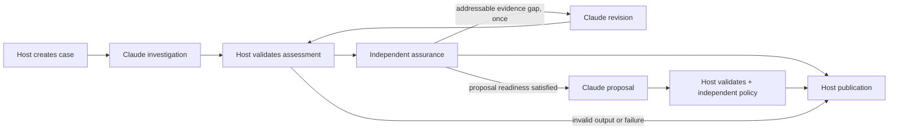

# Investigator M2-B: host-owned Independent Operational Decision Assurance

## Foundation and implementation design

Base: `689caf27533429dbce2defa5e81693fa190d49f3`, the exact M2-A-only commit. Its parent is `fe659bad834d7e56433c0b6e615cab3a95e4da38`. The foundation adds `trust.py` and nine offline contract tests. Successor `4202a5ebfca4f7fbc5268bcf9cc1c251a9f7eb51` adds agent-directed tools, report integration and comparisons; none of those changes were inherited. The frozen `codex/investigator-m2` branch remains unchanged. Work uses a separate `.host-worktree` because the original checkout contains unrelated uncommitted changes.

Previously the agent could decide whether to request assurance. M2-B makes stage completion an application boundary: the host validates an assessment, calls assurance directly, and chooses the next stage. Claude controls reasoning, diagnostics and specialist delegation within each bounded invocation.

Module boundaries:

- `case.py`: typed versioned identity, current projection, immutable JSON event payloads and exclusive filesystem checkpoints. Evidence is scoped to case and permitted query IDs. No database or general event framework.
- `trust.py`: M2-A schemas and independent evaluators, with strict pointers and incident scope; separate proposal-readiness and publication standards. Semantic sufficiency still requires bound human review. Only curator changes have a sandbox verification path.
- `orchestration.py`: explicit transition graph, validated stage envelopes, one evidence revision, mandatory evaluation and final publication. Replaceable async executor permits offline test doubles.
- `agent/stages.py`: separate SDK invocations with structured output, explicit context, host timeouts and per-stage turn ceilings. Only diagnostic tools and two existing specialists; no patching, replay or publication capability.
- `report.py`: existing strict findings validation and atomic immutable publication, extended to include the authoritative case.



Transitions are host-only: created → investigation → assurance; assurance may enter revision once, proposal, or publication; revision returns to assurance; proposal enters policy; policy enters publication; publication finishes. Failures enter publication with an incomplete outcome. Every assessment and decision records the case/evidence/policy/source binding. A decision is rechecked before use. No decision grants execution authority.

Primary tests cover missing/malformed assessments, contradictory observations, attempted authority injection, scoped evidence, revision feedback and exhaustion, clean outcomes, semantic review stops, prohibited targets, stale decisions, approval requirements, SDK errors/timeouts/cancellation and immutable publication. No live model, telemetry, production resource, or paid experiment is needed.

SDK compatibility: the installed SDK exposes `ClaudeAgentOptions.output_format` and `ResultMessage.structured_output`. Structured output still requires host validation; missing output or an error result fails closed. Streaming input remains necessary for the permission callback. See [official SDK structured-output documentation](https://code.claude.com/docs/en/agent-sdk/structured-outputs). Fresh invocations isolate failures at the cost of resending relevant case context. No custom agent runtime is introduced.

Restart support is inspection only: an existing case ID cannot be reopened for execution. Checkpoints do not use fsync or transactional crash recovery, so this is not crash-safe durability. A process kill may leave an incomplete last checkpoint; earlier files remain inspectable.

M2-C and its comparative harness are deferred. This follows the explicit M2-B-only milestone and future-evaluation instructions despite deliverable 7 listing a comparative harness.

## Implemented contracts and compatibility

The case schema is version 1. Stage submissions reject unknown fields and use the frozen strict M2-A models. Finding dictionaries still go through M1.5's strict parser; agent verification assertions are rejected. Runtime evidence binds to case and query IDs, including the current finding's IDs. Source and aggregate records cannot satisfy runtime facts. JSON Pointer rejects negative, signed, zero-padded, non-ASCII and malformed array indices and invalid escapes.

M2-A gains additive `proposal_readiness` and `publication` steps. `proceed` means only that a bounded workflow transition is ready; `read_only_permitted` separates authorized reading from diagnostic evidence requests. Existing four action outcomes and `execution_authorized=false` remain. The default version is `reelix-m2-host-v1`, and the full policy content determines its revision. Evidence IDs and review subjects change when incident scope changes. Consumers that enumerate outcomes or construct old unscoped records must update; the frozen comparison implementation is untouched.

Proposal readiness independently checks exact observed runtime fields, finding binding, source resolution and representation of a plausible mechanism. It does not establish semantic adequacy or causal proof. Stronger sandbox conditions retain M2-A bound human reviews. Safe proposal drafting does not require all sandbox conditions. Non-curator proposals have an explicit unavailable-verification condition and approval-required outcome even if further diagnostic evidence is also absent. No verification engine is invented for them.

`VerificationPlan.baseline_controls_before_candidate` is fixed to true. This specifies M1.5's sequencing prerequisite; it does not claim baseline/control executions occurred. No receipts are synthesized. Source identity reuses M1.5's Python source manifest digest, while Git commit identity is recorded separately. Existing attested fresh-process replay, full replay/judge coverage, receipt acceptance and production-recovery distinctions are unchanged.

The default application entry point now uses the host path exclusively. Legacy `--apply` fails before database or SDK access, and shell helpers deny in all modes. SDK stages expose neither publication nor replay nor file-writing tools. Builtin readers are replaced by the scoped source reader, which also prevents reads of local credential files. Existing legacy tool handlers remain reusable library functions and retain their M1.5 tests, but their server is never supplied to a host stage. `build_options` now requires a scoped executor and request. The application does not initialize replay/judge clients.

## Offline validation and failure injection

The final suite contains 77 deterministic tests. It includes the nine original M2-A tests and all existing M1.5 persistence, strict publication, fresh-process replay and verification tests. B1 passed its 12 case/contract tests before host integration; B2 passed 68 regression tests before the SDK adapter was connected.

| Required behavior | Evidence in tests |
|---|---|
| 1. Automatic assurance | Valid assessment invokes the host evaluator twice; default `run()` also tested with a fake SDK stream |
| 2–3. Missing/malformed/contradictory output | No assessment cannot enter assurance or proposal; contradictory runtime value exhausts one revision and remains provisional |
| 4–6. Feedback/revision/exhaustion | Specific unmet condition and next action delivered; new runtime observation changes snapshot; no improvement yields exactly two investigation submissions and two evaluations |
| 7–8. Skip/authority escalation | Early proposal, condition statuses, approval, evidence payload and receipt injections fail; verified finding assertions rejected |
| 9. Currency | Evidence/policy changes during drafting invalidate readiness; changed proposal invalidates favorable decision before publication; M2-A tests cover all input bindings |
| 10. Clean outcome | One assessment, mandatory assurance, empty findings, no proposal; integrated fake SDK path publishes |
| 11–13. Risk and approval | Prohibited high-confidence target denied; trusted reviews without approval remain approval-required; fully bound trusted reviews can yield sandbox eligibility |
| 14. No execution authority | Actual SDK tools/options exclude execution/publication; `--apply` rejected before I/O; even favorable decisions never authorize execution |
| 15. Failure consistency | SDK empty/error/missing-output/late transport failure, host timeout/cancellation and publication failure leave inspectable histories and consistent terminal status |

Additional checks cover incident-query isolation, source scope/manifest changes, no-action proposals, denied read access, restricted proposal capability and prevention of historical report replacement. Tests inspect actual host transition sequences and report artifacts, not only evaluator return values.

Reproduce from this worktree with the existing environment:

```sh
PYTHONPATH=packages/python /Users/jjtsao/Projects/Reelix/apps/jobs/.venv/bin/python \
  -m unittest discover -s apps/jobs/tests -p 'test_investigator_*.py' -v
```

## Actual offline stage trace

The checked-in [trace](fixtures/investigator-m2-host-trace.json) captures a real `HostOrchestrator` run using the deterministic fixture from `test_actionable_feedback_revision_and_fresh_snapshot`. It is synthetic control-flow evidence, not a live diagnosis or comparison experiment.

```text
created → investigation → assurance
  request_evidence: runtime observation reference unresolved
  host delivers condition-specific feedback; one revision remains
→ revision → assurance
  new scoped runtime observation registered; evidence snapshot changes
  proceed: proposal-readiness conditions satisfied
→ proposal → policy
  request_evidence: semantic mechanism/causal/risk reviews remain unresolved
→ publication → finished
  provisional; full proposal and unmet requirements preserved; execution=false
```

A separate host test installs fully bound synthetic host reviews and demonstrates `sandbox_candidate`; another omits approval and demonstrates `require_approval`. These are explicitly trusted test fixtures, not agent-generated reviews. No live human approval mechanism is implemented.

## Overhead and what the evidence demonstrates

At most three SDK invocations occur: investigation, optional revision and optional proposal. There are one to three mandatory evaluator checkpoints plus local currency reevaluations. Fresh sessions resend relevant case/evidence context; full history is retained on disk rather than recursively inserted into stage prompts. Token use, SDK turn/cost metadata, host stage elapsed time, stage input/output and policy/source/evidence identities are recorded.

In the captured synthetic run, three checkpoint evaluations took approximately 0.15, 0.11 and 0.14 milliseconds; the entire deterministic host run including filesystem/report work took about 11.9 milliseconds on this machine. These are illustrative observations, not latency benchmarks. Live token cost, subagent behavior and SDK latency were not measured. Extra SDK session startup/context transfer will dominate local evaluator cost. No paid experiments ran.

The evidence establishes mandatory checkpoints and bounded host progression with deterministic execution doubles, and adapter behavior under fake SDK streams. It does not establish improved real-agent diagnostic calibration, better causal inference, production incident recovery or live SDK/model interoperability. Those require separately reviewed future evaluation.

## Known limits and next steps

- One current finding/assessment and one current proposal per case; earlier revisions remain in history. Multiple independent findings should use separate cases in this PoC.
- Cases persist across stage invocations but cannot resume execution after restart. Checkpoints are append-only snapshots without fsync, locking or crash recovery; a hard kill may leave a partial last file. No distributed or adversarial filesystem integrity is claimed.
- `asyncio.wait_for` provides cooperative cancellation. Synchronous database/tool work may delay timeout delivery; database/network timeouts still depend on existing clients. Live subprocess cleanup after cancellation has not been exercised.
- The existing tool context is process-global; concurrent cases in a single process are unsupported. The CLI runs one case at a time.
- Exact observation matching proves a field was observed, not that an interpretation or clean-system conclusion is semantically correct. Clean means no finding submitted within the observed scope, not production health certification. Unknown semantic conditions remain inspectable.
- Human review injection is host-only Python API, without a new human review UI or identity service. Default live runs generally remain provisional when semantic review is mandatory.
- Read-only scope discovery retrieves authorized query IDs before case initialization. Startup/preflight/scope-discovery failures can occur before a case exists. Empty or inaccessible runtime evidence cannot produce a certified clean result.
- Proposals are reviewable structured text. No patch application, replay automation, deployment, production execution, generalized action registry, M2-C runner or comparative experiments are included.

M2-B stops here for architecture and implementation review. M2-C can later replace the stage executor, reuse frozen evidence, and compare the three frozen architectures without adding comparison-specific logic to this orchestrator.
